<p align="right"><sub><b>English</b> · <a href="README.md">Español</a></sub></p>

<p align="center">
  
</p>

<p align="center">
  <a href="https://github.com/agustinyarrus/cupo/releases/latest"></a>
  
  
  
  
  <a href="LICENSE"></a>
</p>

<h3 align="center">How much Claude do you have left? And Codex, Antigravity, Grok?<br>One click on the Windows tray and you know. For all of them.</h3>

<p align="center">
  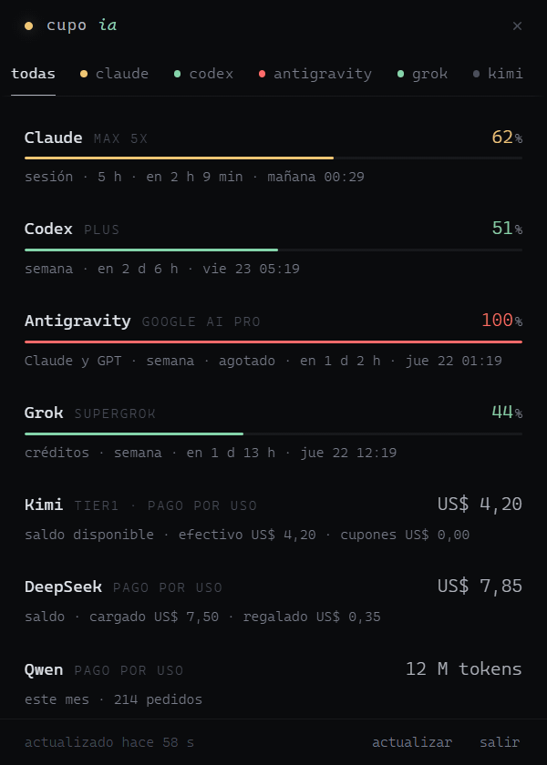
</p>
<p align="center"><sub>The real panel going through its 12 tabs, with demo data · <a href="docs/pestanas.webm">as video</a> · <a href="tools/grabar.mjs">how it was recorded</a></sub></p>

<br>

<table>
<tr>
<td width="33%" valign="top">

### All your AIs, for real

**11 AIs**, one tab each: Claude, Codex, Antigravity, Grok, Kimi, DeepSeek, Qwen, You.com, Mistral, Copilot and Z.ai. The ones you don't use don't show up.

</td>
<td width="33%" valign="top">

### Every detail

Not just a percentage. You get the session and the week, per-model limits and credits. Also saved resets, the usage breakdown and your plan. Plus what each CLI logged on your PC, with a per-day chart.

</td>
<td width="33%" valign="top">

### Barely there

**2 MB** with the panel closed. **No** background polling: it learns you used an AI because Windows tells it. The panel frees all its memory when it closes.

</td>
</tr>
</table>

## What it costs, measured

|  | cupo, panel closed | another usage app (Claude only) |
|---|---|---|
| AIs | **11** | 1 |
| RAM | **5.7 MB working set · 2.0 MB private** | 411 MB between its exe and its WebView2 |
| WebView2 processes | **0** | 5 |

<sub>Measured on October 20, 2026, on the same PC (Windows 11), with both running as usual. The other app is Usage Monitor for Claude 1.20. With its panel open, cupo adds about 330 MB of WebView2 until you close it.</sub>

## The tabs

<table>
<tr>
<td align="center" valign="top" width="25%">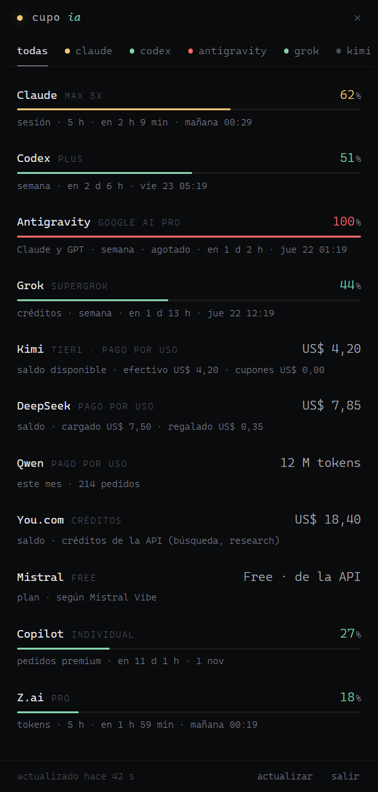<br><sub><b>all</b></sub></td>
<td align="center" valign="top" width="25%">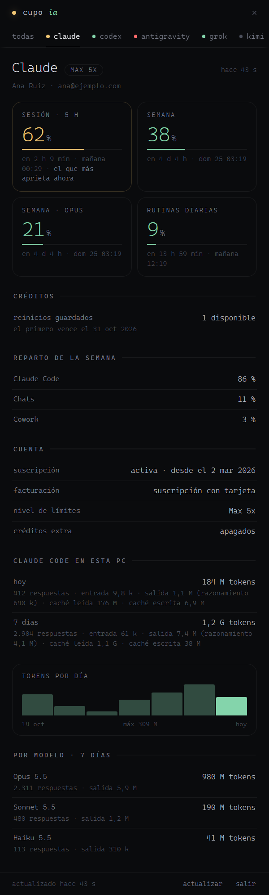<br><sub><b>claude</b></sub></td>
<td align="center" valign="top" width="25%">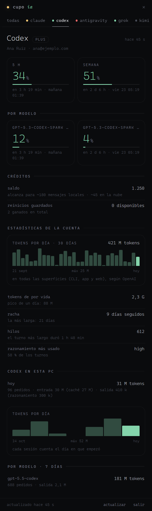<br><sub><b>codex</b></sub></td>
<td align="center" valign="top" width="25%">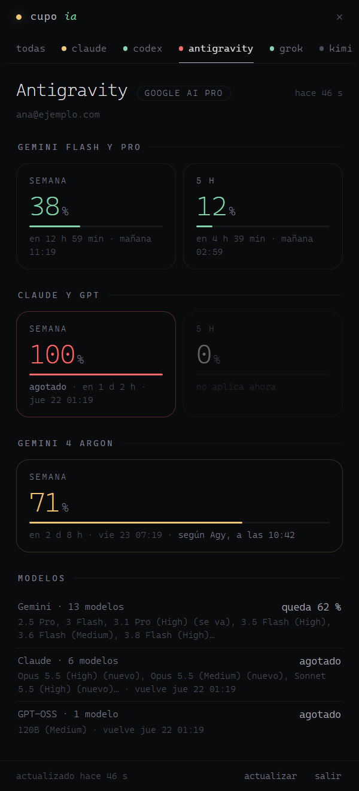<br><sub><b>antigravity</b></sub></td>
</tr>
<tr>
<td align="center" valign="top">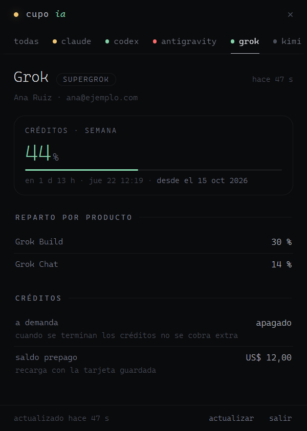<br><sub><b>grok</b></sub></td>
<td align="center" valign="top">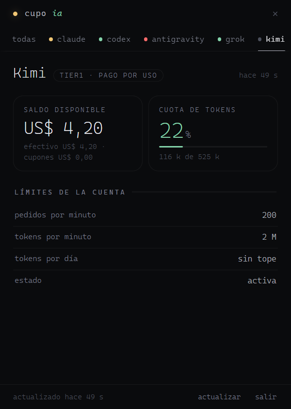<br><sub><b>kimi</b></sub></td>
<td align="center" valign="top">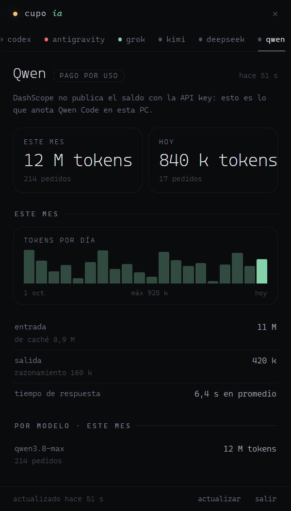<br><sub><b>qwen</b></sub></td>
<td align="center" valign="top">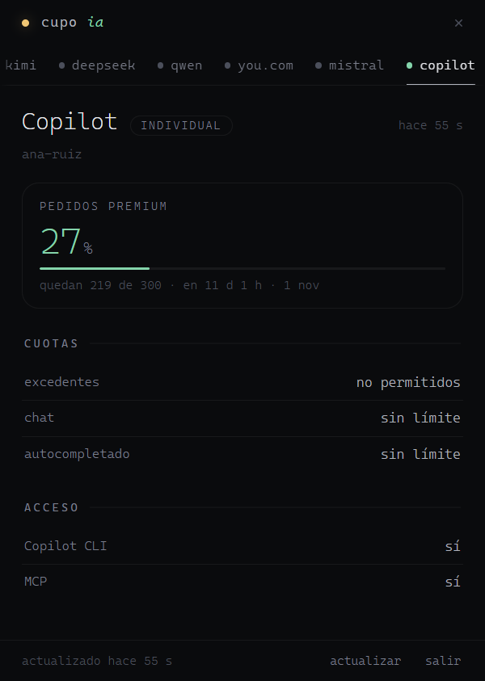<br><sub><b>copilot</b></sub></td>
</tr>
</table>

<sub>The UI is in Spanish (Argentina). Every screenshot uses made-up data: <code>node tools/grabar.mjs</code> builds the panel with a demo state and records it with headless Chrome.</sub>

## What it sees of each AI

| AI | What it shows | Where it comes from |
|---|---|---|
| **Claude** | 5 h session, week, per-model weeks, routines, extra and cloud credits, saved resets, breakdown (Claude Code, chats, Cowork), account and plan; Claude Code tokens today and over 7 days, per day and per model | `api.anthropic.com/api/oauth/usage` and `/profile`, with Claude Code's session; `~/.claude/projects` |
| **Codex** | windows (5 h, week or 30 days), per-model limits, code reviews, credits, saved resets; tokens per day, lifetime, streak, threads, most-used reasoning; Codex tokens on this PC | `chatgpt.com/backend-api/wham/*`, with Codex's session; `~/.codex/sessions` |
| **Antigravity** | plan; Gemini Flash and Pro, Claude and GPT (week and 5 h); Gemini 4 Argon; the models of each family | `cloudcode-pa.googleapis.com/v1internal:*`, with Agy's session; Argon from Agy's statusline (see below) |
| **Grok** | plan (SuperGrok, X Premium), weekly credits, per-product breakdown, on-demand, prepaid balance | `cli-chat-proxy.grok.com/v1/billing` and `/settings`, with Grok CLI's session |
| **Kimi** | balance, debt, vouchers, token quota, account limits, status | `api.moonshot.ai/v1/users/me/balance` and `/users/me` |
| **DeepSeek** | balance, topped up and granted | `api.deepseek.com/user/balance` |
| **Qwen** | tokens this month and today, per day, per type and per model; response time | what Qwen Code logs (DashScope doesn't publish the balance with an API key) |
| **You.com** | balance | `api.you.com/v1/billing/account_balance` |
| **Mistral** | plan | what Mistral Vibe caches (Mistral doesn't publish usage with an API key) |
| **Copilot** | subscription status, premium requests, chat, completions, overage | `api.github.com/copilot_internal/user`, with Copilot CLI's session |
| **Z.ai** | Coding Plan limits (tokens, tools) | `api.z.ai/api/monitor/usage/quota/limit` |

## How it stays out of the way

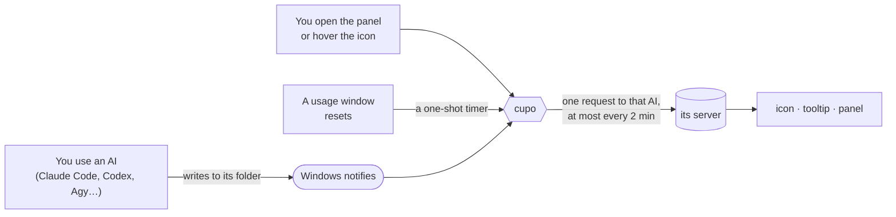

- **No repeating timers.** If you aren't using any AI, cupo does nothing: its thread sleeps in the kernel until Windows wakes it (`FindFirstChangeNotification`).
- **On-demand panel.** It's WebView2 and weighs as much as a browser while open (about 330 MB). When it closes, Windows ends its processes and cupo returns the memory and trims its working set.
- **Reads incrementally.** From Claude Code's and Codex's history it only reads what was appended since last time.
- **No open connections** between requests.

## Install

1. Download `cupo.exe` from the [latest release](https://github.com/agustinyarrus/cupo/releases/latest). Check `SHA256SUMS.txt` if you like.
2. Put it in a folder of yours, e.g. `C:\Tools\cupo\`. Its data goes in `data\`, next to the exe.
3. Run it. The icon appears in the tray and the panel opens next to it.

Needs Windows 10 or 11 with the WebView2 runtime (it ships with Windows 11 and with Edge). No admin rights, nothing installed.

| Action | How |
|---|---|
| See the panel | click the icon · it closes when you click elsewhere, with <kbd>Esc</kbd> or the × |
| Switch tabs | click, the mouse wheel over the tab row, or <kbd>←</kbd> <kbd>→</kbd> |
| Refresh | the "actualizar" button, <kbd>F5</kbd> or the icon's menu |
| Quit | "salir" in the panel (two taps), the icon's menu, or `cupo.exe --quit` |

The **icon** is two thin rings: Claude's session outside, the week inside. It's green below 60 %, amber up to 85 %, coral up to 100 % and red when it ran out. The tooltip and the menu summarize every AI.

## Your credentials

- cupo **asks for no login**. It uses the session each CLI already left on your PC (config files and the Windows Credential Manager), only to ask **that AI's own server** for usage.
- It doesn't store or write them, and they never reach the log. It sends nothing anywhere else.
- **It never refreshes a token that the CLI rotates** (Claude, Codex, Grok). Doing so would log your CLI out. If it expired, the tab shows the last known data and how to renew it.
- Antigravity is refreshed in memory, because Google doesn't rotate the refresh token. Agy's OAuth client secret isn't in the code: it's looked up once inside `agy.exe` and kept in `data\cache.json`.

## Questions

<details>
<summary><b>Where does Gemini 4 Argon come from?</b></summary>

The Cloud Code API doesn't publish that bucket (`gemini-argon-wtu-weekly`). Tested with the account's project and with several client identities. Agy does receive it and passes it to its **statusline** on every render.

If your statusline saves that payload to `%TEMP%\sl\quota.cache`, as `sl` does, cupo watches that folder and takes from it the buckets the API doesn't return, with the time Agy showed them. Until you use Agy once, the tab says "sin dato todavía" (no data yet).

</details>

<details>
<summary><b>Does it start with Windows?</b></summary>

No, on purpose: it opens when you open it. If you want it at sign-in, put a shortcut to `cupo.exe` in `shell:startup`.

</details>

<details>
<summary><b>Why is an AI missing?</b></summary>

It didn't find that AI's session on your PC. cupo only shows the AIs you have set up.

</details>

<details>
<summary><b>What if a server fails?</b></summary>

The tab keeps the last known data, with its age and the error. If a server asks to wait (429), cupo waits 5 minutes before asking it again.

</details>

## Build

```powershell
.\build.ps1          # dist\cupo.exe
.\build.ps1 -Test    # go vet + tests (they touch neither the network nor your credentials)
.\build.ps1 -Icono   # regenerates the exe icon
node tools\grabar.mjs   # README screenshots, GIF and video, with demo data
```

Pure Go (no cgo) with [go-webview2](https://github.com/jchv/go-webview2). The tests use real responses from each server, with personal data removed.

To tweak the design without rebuilding: `CUPO_UI=<ui folder>` (the panel reads its HTML, CSS and JS from there). `CUPO_DEVTOOLS=1` turns on DevTools and keeps the panel open when it loses focus.

## License

[MIT](LICENSE) © 2026 Agustin Yarrus
