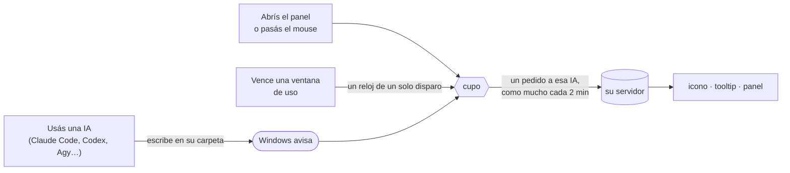

<p align="right"><sub><a href="README.en.md">English</a> · <b>Español</b></sub></p>

<p align="center">
  
</p>

<p align="center">
  <a href="https://github.com/agustinyarrus/cupo/releases/latest"></a>
  
  
  
  
  <a href="LICENSE"></a>
</p>

<h3 align="center">¿Cuánto te queda de Claude? ¿Y de Codex, de Antigravity, de Grok?<br>Un clic en la bandeja de Windows y lo sabés. De todas.</h3>

<p align="center">
  
</p>
<p align="center"><sub>El panel de verdad recorriendo sus 12 pestañas, con datos de demo · <a href="docs/pestanas.webm">en video</a> · <a href="tools/grabar.mjs">cómo se grabó</a></sub></p>

<br>

<table>
<tr>
<td width="33%" valign="top">

### Todas tus IAs, en serio

**11 IAs**, una pestaña cada una: Claude, Codex, Antigravity, Grok, Kimi, DeepSeek, Qwen, You.com, Mistral, Copilot y Z.ai. Las que no usás no aparecen.

</td>
<td width="33%" valign="top">

### Todo el detalle

No sólo un porcentaje. Están la sesión y la semana, los límites por modelo y los créditos. También los reinicios guardados, el reparto de uso y tu plan. Y lo que cada CLI anotó en tu PC, con un gráfico por día.

</td>
<td width="33%" valign="top">

### Casi no existe

**2 MB** con el panel cerrado. **Ninguna** consulta en segundo plano: se entera de que usaste una IA porque Windows le avisa. El panel libera toda su memoria al cerrarse.

</td>
</tr>
</table>

## Lo que gasta, medido

|  | cupo, con el panel cerrado | otra app de uso (sólo Claude) |
|---|---|---|
| IAs | **11** | 1 |
| RAM | **5,7 MB de working set · 2,0 MB privados** | 411 MB entre su exe y su WebView2 |
| Procesos de WebView2 | **0** | 5 |

<sub>Medido el 20 de octubre de 2026 en la misma PC (Windows 11), con las dos corriendo como siempre. La otra app es Usage Monitor for Claude 1.20. Con el panel abierto, cupo suma unos 330 MB de WebView2 hasta que lo cerrás.</sub>

## Las pestañas

<table>
<tr>
<td align="center" valign="top" width="25%"><br><sub><b>todas</b></sub></td>
<td align="center" valign="top" width="25%"><br><sub><b>claude</b></sub></td>
<td align="center" valign="top" width="25%"><br><sub><b>codex</b></sub></td>
<td align="center" valign="top" width="25%"><br><sub><b>antigravity</b></sub></td>
</tr>
<tr>
<td align="center" valign="top"><br><sub><b>grok</b></sub></td>
<td align="center" valign="top"><br><sub><b>kimi</b></sub></td>
<td align="center" valign="top"><br><sub><b>qwen</b></sub></td>
<td align="center" valign="top"><br><sub><b>copilot</b></sub></td>
</tr>
</table>

<sub>Todas las capturas usan datos inventados: <code>node tools/grabar.mjs</code> arma el panel con un estado de demo y lo graba con Chrome sin ventana.</sub>

## Qué ve de cada IA

| IA | Qué muestra | De dónde lo saca |
|---|---|---|
| **Claude** | sesión de 5 h, semana, semanas por modelo, rutinas, créditos extra y de nube, reinicios guardados, reparto (Claude Code, chats, Cowork), cuenta y plan; tokens de Claude Code de hoy y de 7 días, por día y por modelo | `api.anthropic.com/api/oauth/usage` y `/profile`, con la sesión de Claude Code; `~/.claude/projects` |
| **Codex** | ventanas (5 h, semana o 30 días), límites por modelo, revisiones de código, créditos, reinicios guardados; tokens por día, de por vida, racha, hilos y razonamiento más usado; tokens de Codex en esta PC | `chatgpt.com/backend-api/wham/*`, con la sesión de Codex; `~/.codex/sessions` |
| **Antigravity** | plan; Gemini Flash y Pro, Claude y GPT (semana y 5 h); Gemini 4 Argon; los modelos de cada familia | `cloudcode-pa.googleapis.com/v1internal:*`, con la sesión de Agy; Argon, de la statusline de Agy (ver abajo) |
| **Grok** | plan (SuperGrok, X Premium), créditos de la semana, reparto por producto, a demanda, saldo prepago | `cli-chat-proxy.grok.com/v1/billing` y `/settings`, con la sesión de Grok CLI |
| **Kimi** | saldo, deuda, cupones, cuota de tokens, límites de la cuenta, estado | `api.moonshot.ai/v1/users/me/balance` y `/users/me` |
| **DeepSeek** | saldo, cargado y regalado | `api.deepseek.com/user/balance` |
| **Qwen** | tokens del mes y de hoy, por día, por tipo y por modelo; tiempo de respuesta | lo que anota Qwen Code (DashScope no publica el saldo con la API key) |
| **You.com** | saldo | `api.you.com/v1/billing/account_balance` |
| **Mistral** | plan | lo que guarda Mistral Vibe (Mistral no publica el uso con la API key) |
| **Copilot** | estado de la suscripción, pedidos premium, chat, autocompletado, excedentes | `api.github.com/copilot_internal/user`, con la sesión de Copilot CLI |
| **Z.ai** | límites del Coding Plan (tokens, herramientas) | `api.z.ai/api/monitor/usage/quota/limit` |

## Cómo hace para no gastar



- **Ningún temporizador repetido.** Si no usás ninguna IA, cupo no hace nada: el hilo duerme en el kernel hasta que Windows le avisa (`FindFirstChangeNotification`).
- **Panel a demanda.** Es WebView2 y pesa lo que un navegador mientras está abierto (unos 330 MB). Al cerrarlo, Windows termina sus procesos y cupo devuelve la memoria y vacía su working set.
- **Lee de a poco.** De los historiales de Claude Code y Codex lee sólo lo que se agregó desde la vez anterior.
- **Sin conexiones abiertas** entre pedidos.

## Instalar

1. Bajá `cupo.exe` de la [última versión](https://github.com/agustinyarrus/cupo/releases/latest). Verificá el `SHA256SUMS.txt` si querés.
2. Ponelo en una carpeta tuya, por ejemplo `C:\Herramientas\cupo\`. Sus datos van en `data\`, al lado del exe.
3. Abrilo. Aparece el icono en la bandeja y el panel junto a ella.

Necesita Windows 10 u 11 con el runtime de WebView2 (viene con Windows 11 y con Edge). No pide permisos de administrador ni instala nada.

| Acción | Cómo |
|---|---|
| Ver el panel | clic en el icono · se cierra al hacer clic afuera, con <kbd>Esc</kbd> o con la × |
| Cambiar de pestaña | clic, la rueda del mouse sobre la fila, o <kbd>←</kbd> <kbd>→</kbd> |
| Actualizar | botón "actualizar", <kbd>F5</kbd> o el menú del icono |
| Salir | "salir" en el panel (dos toques), el menú del icono, o `cupo.exe --quit` |

El **icono** son dos anillos finos: afuera la sesión de Claude, adentro la semana. Es verde por debajo de 60 %, ámbar hasta 85 %, coral hasta 100 % y rojo cuando se agotó. El tooltip y el menú resumen cada IA.

## Tus credenciales

- cupo **no pide ningún login**. Usa la sesión que ya dejó cada CLI en tu PC (archivos de config y el Administrador de credenciales de Windows), sólo para pedirle el uso a **su propio servidor**.
- No las guarda, no las escribe y nunca van al log. Tampoco manda nada a ningún otro lado.
- **Nunca renueva un token que la CLI rota** (Claude, Codex, Grok). Renovarlo dejaría a tu CLI sin sesión. Si venció, la pestaña muestra lo último que se supo y cómo renovarlo.
- Antigravity sí se renueva, en memoria, porque Google no rota el refresh token. El secreto del cliente OAuth de Agy no está en el código: se busca una vez en `agy.exe` y queda en `data\cache.json`.

## Preguntas

<details>
<summary><b>¿De dónde sale Gemini 4 Argon?</b></summary>

La API de Cloud Code no publica ese balde (`gemini-argon-wtu-weekly`). Probado con el proyecto de la cuenta y con varias identidades de cliente. Agy sí lo recibe y se lo pasa a su **statusline** en cada render.

Si tu statusline guarda ese payload en `%TEMP%\sl\quota.cache`, como hace `sl`, cupo escucha esa carpeta y toma de ahí los baldes que la API no trae, con la hora en que Agy los mostró. Hasta que usás Agy una vez, la pestaña dice "sin dato todavía".

</details>

<details>
<summary><b>¿Arranca con Windows?</b></summary>

No, a propósito: se abre cuando lo abrís. Si lo querés al iniciar sesión, poné un acceso directo a `cupo.exe` en `shell:startup`.

</details>

<details>
<summary><b>¿Por qué una IA no aparece?</b></summary>

Porque no encontró su sesión en tu PC. cupo sólo muestra las IAs que tenés configuradas.

</details>

<details>
<summary><b>¿Y si un servidor falla?</b></summary>

La pestaña queda con lo último que se supo, con su antigüedad y el error. Si un servidor pide esperar (429), cupo espera 5 minutos antes de volver a pedirle.

</details>

## Compilar

```powershell
.\build.ps1          # dist\cupo.exe
.\build.ps1 -Test    # go vet + pruebas (no tocan la red ni tus credenciales)
.\build.ps1 -Icono   # regenera el icono del exe
node tools\grabar.mjs   # capturas, GIF y video del README, con datos de demo
```

Go puro (sin cgo) con [go-webview2](https://github.com/jchv/go-webview2). Las pruebas usan respuestas reales de cada servidor, sin datos personales.

Para retocar el diseño sin recompilar: `CUPO_UI=<carpeta ui>` (el panel lee HTML, CSS y JS de ahí). `CUPO_DEVTOOLS=1` prende las DevTools y deja el panel abierto aunque pierda el foco.

<details>
<summary><b>Qué hace cada archivo</b></summary>

| Archivo | Qué hace |
|---|---|
| `main.go` | instancia única y `--quit` |
| `app.go` | cuándo se pide cada IA (eventos y relojes de un disparo), estado, cache, log y memoria |
| `ias.go` | modelo de datos, registro de proveedores, pedidos HTTP y formatos |
| `claude.go`, `codex.go`, `agy.go`, `otras.go` | un lector por IA, probados en `ias_test.go` |
| `cred_windows.go` | lee el Administrador de credenciales |
| `tray_windows.go`, `icons.go` | el icono de dos anillos, el tooltip y el menú |
| `panel_windows.go`, `placement_windows.go`, `geom.go` | el panel WebView2 sin marco: nace junto a la bandeja, no ocupa la barra de tareas y recuerda dónde lo dejaste |
| `ui/` | el panel: HTML, CSS y JS embebidos en el exe |
| `tools/grabar.mjs`, `tools/foto.mjs` | las capturas, el GIF y la portada del README |

</details>

## Licencia

[MIT](LICENSE) © 2026 Agustin Yarrus
